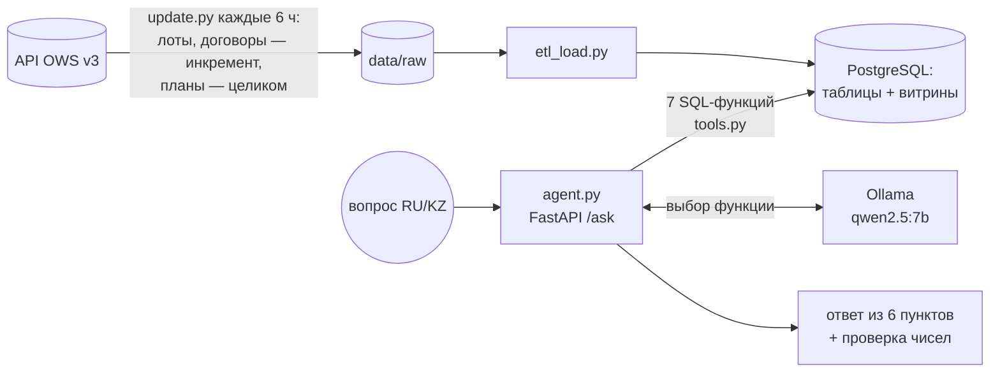

# Аналитический AI-агент по госзакупкам (УДП РК)

Агент отвечает на вопросы на казахском и русском по закупкам 27 организаций (`bins.txt`) за 2024–2026 годы.
Данные берутся из API OWS v3 портала goszakup.gov.kz. Агент сам определяет тип вопроса, считает
SQL-запросами по локальному хранилищу и отвечает по шаблону из 6 пунктов: только цифры из данных, с методом,
уверенностью и прямыми ссылками на договоры и объявления портала.



PNG-версия схемы: [overview.png](docs/img/overview.png)

LLM только выбирает функцию. Все числа считает SQL, текст ответа собирается кодом, проверка `verify` сверяет
числа вывода с данными. Подробно — в [docs/architecture.md](docs/architecture.md).

## Соответствие требованиям

| Требование ТЗ | Как выполнено | Где |
|---|---|---|
| Данные 27 организаций за 2024–2026 | все 27 БИН из ТЗ; планы, лоты, договоры, объявления 2024–2026 | [data_model.md](docs/data_model.md) |
| Охват данных: выбрать и обосновать сущности OWS v3 (объявления, план, договоры, лоты, вид предмета, заказчики, поставщики, статусы, справочники) | все 9 загружены; обоснование по каждой и по незагружаемым эндпоинтам (`Ob*`, `TrdApp`, `Acts`, `Rnu` …) | [data_model.md](docs/data_model.md#охват-данных-и-обоснование-выбора-сущностей) |
| ETL: очистка и нормализация (единицы, мусор в названиях лотов) | нормализация единиц, очистка названий, город по КАТО, журнал качества | [data_model.md](docs/data_model.md#очистка-и-нормализация-etl) |
| Методы анализа (статистика / ML / правила) | статистика (медиана, средневзвешенная, IQR, MAD, robust z) + правила; почему не Isolation Forest/LOF | [analytics.md](docs/analytics.md#выбор-методов) |
| Вопросы на KZ/RU, тип определяется сам | 7 функций: аномалии, справедливость цены лота, объёмы, сравнение, аналитика, карточка договора, поиск; ответ на языке вопроса | [architecture.md](docs/architecture.md#агент) |
| LLM не считает, ответы воспроизводимы | расчёты в SQL; ответ собирается из результата функции; проверка каждого числа, даты и БИН вывода | [architecture.md](docs/architecture.md#4-проверка-чисел) |
| Аномалии: отклонение цены > 30% от средневзвешенной по ЕНС ТРУ | `find_price_anomalies`: средневзвешенная по количеству, robust z, IQR, переплата | [analytics.md](docs/analytics.md#1-ценовые-аномалии-find_price_anomalies) |
| Справедливость цены лота относительно других ведомств в том же городе | `assess_lot_price`: Fair Price = P_base × K_region × K_season по каждому пункту лота | [analytics.md](docs/analytics.md#2-справедливость-цены-лота--fair-price-assess_lot_price) |
| Нетипичное завышение количества относительно прошлых лет | `find_volume_spikes`: количество года против медианы прошлых лет | [analytics.md](docs/analytics.md#3-нетипичное-завышение-объёмов-find_volume_spikes) |
| Формат ответа из 6 пунктов, без общих фраз | шаблоны RU/KZ для каждого типа вопроса | [examples.md](docs/examples.md) |
| Explainability: ID и ссылки, N выборки, число объектов, метод, уверенность и ограничения | в каждом ответе (разделы 2–6), N и число проверенных объектов в разделах 3 и 5 | [examples.md](docs/examples.md) |
| Контроль качества данных | журнал `dq_issues` (9 видов проблем), защита от неполной выгрузки, сверка с API | [data_model.md](docs/data_model.md#журнал-качества-данных-dq_issues) |
| Точность извлечения фактов ≥ 85% | 67 вопросов, независимые эталоны: 88–94% на первых прогонах отложенных вопросов, 100% после исправлений (в т. ч. в Docker) | [quality.md](docs/quality.md) |
| Обновление с задержкой ≤ 24 ч | `update.py` каждые 6 ч: инкремент 11–24 мин; дата актуальности в каждом ответе и в `/health` | [architecture.md](docs/architecture.md#обновление-данных-updatepy) |
| Метрика Fair Price (аналоги + регион + инфляция и сезонность) | реализована: медиана аналогов других ведомств × региональный × сезонный коэффициент; все цены приведены по помесячному ИПЦ Бюро нацстатистики к ценам сентября 2026 (`cpi.csv`) | [analytics.md](docs/analytics.md#2-справедливость-цены-лота--fair-price-assess_lot_price) |
| Защита токена | токен только в `.env` и переменной сервиса обновления; не в образе и не в git | [risks.md](docs/risks.md#эксплуатация) |
| On-prem: Docker, Kubernetes | `docker compose up -d --build`; манифесты `k8s/` | [k8s/README.md](k8s/README.md) |

## Документы для сдачи

| Документ | Содержание |
|---|---|
| [docs/architecture.md](docs/architecture.md) | архитектура: компоненты, конвейер агента, проверка чисел, казахский язык, обновление данных, развёртывание (схемы Mermaid) |
| [docs/data_model.md](docs/data_model.md) | схема хранения: ER-диаграмма, таблицы и витрины с числом строк, правила ETL, журнал качества данных |
| [docs/analytics.md](docs/analytics.md) | аналитика и метрики: формулы, пороги, уверенность |
| [docs/examples.md](docs/examples.md) | 10 реальных ответов агента целиком (все обязательные типы, 3 на казахском) |
| [docs/quality.md](docs/quality.md) | оценка качества: методика, эталоны, результаты, найденные ошибки |
| [docs/risks.md](docs/risks.md) | риски и ограничения: данные, LLM, эксплуатация |
| [k8s/README.md](k8s/README.md) | развёртывание в Kubernetes |

## Быстрый запуск (Docker)

Нужны Docker с Compose и около 8 ГБ памяти для Docker (модель 7B занимает около 5 ГБ).

1. Создать файл настроек и заполнить в нём `GOSZAKUP_TOKEN` и `POSTGRES_PASSWORD`:
   ```bash
   cp .env.example .env
   ```
2. Поднять стек:
   ```bash
   docker compose up -d --build
   ```
3. Проверить состояние:
   ```bash
   curl localhost:8080/health
   ```
4. Задать вопрос:
   ```bash
   curl -X POST localhost:8080/ask -H 'Content-Type: application/json' -d '{"question": "Найди закупки с отклонением цены больше 30% от средневзвешенной по ЕНС ТРУ"}'
   ```

Что важно знать:
- **Пустая база.** Первый запуск сервиса `updater` выполняет полную выгрузку 27 организаций, около 3,5 ч.
  Ход видно в логах: `docker compose logs -f updater`.
- **Модель.** Скачивается при первом запуске (сервис `ollama-pull`, 4,7 ГБ).
- **Mac.** Модель в контейнере работает на CPU, 4–11 с на вопрос. Быстрее с Ollama на хосте
  (`ollama pull qwen2.5:7b`):
  ```bash
  docker compose -f docker-compose.yml -f docker-compose.host-llm.yml up -d --build
  ```

## Локальный запуск без Docker (разработка)

Нужны Python 3.12+, PostgreSQL на порту 5433 (`docker compose up -d postgres`) и Ollama с моделью qwen2.5:7b.
В `.env` задать `GOSZAKUP_TOKEN` и `DATABASE_URL=postgresql://postgres:<пароль>@127.0.0.1:5433/goszakup`.

1. Установить зависимости:
   ```bash
   pip install -r requirements.txt
   ```
2. Выгрузить данные и собрать базу и витрины (на пустой базе — полная выгрузка):
   ```bash
   python update.py
   ```
3. Задать вопрос в терминале:
   ```bash
   python agent.py "Ұлттық госпиталь 2025 жылы қандай тауарлардың көлемін асыра көбейтті?"
   ```
4. Запустить HTTP-сервис (`POST /ask`, `GET /health`):
   ```bash
   uvicorn agent:app --port 8080
   ```
5. Прогнать оценку качества (67 вопросов):
   ```bash
   python run_eval.py
   ```
6. Прогнать тесты инкрементального обновления:
   ```bash
   python test_update.py
   ```

Проверить отдельную аналитическую функцию без LLM:

```bash
python tools.py anomalies --top 5
```

Доступные функции `tools.py`: `anomalies`, `lot`, `volumes`, `search`, `compare`, `contract`, `analytics`.

## Структура проекта

| Файл | Назначение |
|---|---|
| `fetch_raw.py` | первичная полная выгрузка API, общие функции запросов (`gql`, `fetch_all`) |
| `update.py` | регулярное обновление: инкремент лотов и договоров, снимок планов, ETL и витрины в одной транзакции, журнал `etl_runs` |
| `scheduler.py` | планировщик для контейнера `updater` |
| `fetch_missing_plans.py`, `fetch_refs.py` | догрузка пунктов плана для договоров; справочники способов закупки и статусов |
| `schema.sql`, `etl_load.py` | таблицы и ETL: нормализация единиц, город по КАТО, синхронизация удалений, журнал качества |
| `analytics.sql`, `build_marts.py` | витрины: статистика цен, сезонность, аномалии, объёмы |
| `tools.py` | 7 аналитических функций агента (SQL, только чтение) |
| `agent.py` | агент: маршрутизация, ответ из 6 пунктов RU/KZ, проверка чисел, FastAPI |
| `run_eval.py`, `eval_cases.json` | оценка качества с независимыми эталонами |
| `test_update.py` | тесты инкрементального обновления |
| `Dockerfile`, `docker-compose.yml`, `docker-compose.host-llm.yml`, `.env.example` | развёртывание |
| `k8s/` | манифесты Kubernetes |
| `docs/` | документация для сдачи |

## Текущее состояние (16.10.2026)

- **Данные:** 27 организаций; 81 173 пункта плана, 115 800 лотов, 36 922 договора, 105 691 позиция, 9 093 поставщика.
  Актуальны на 16.10.2026 02:14; цены приведены по ИПЦ к ценам сентября 2026.
- **Качество:** eval 67/67 (100%) на хосте и в Docker на финальном коде с учётом инфляции; тесты обновления 5/5.
- **Не сделано:**
  - нет авторизации на `/ask`, TLS и мониторинга;
  - манифесты Kubernetes не проверены на кластере;
  - поставщик ищется только по БИН, нет фильтра по городу и составных вопросов.

  Полный перечень — в [docs/risks.md](docs/risks.md).
