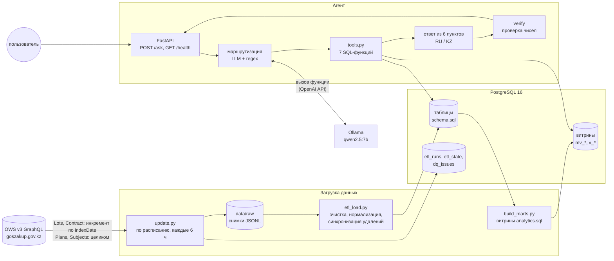
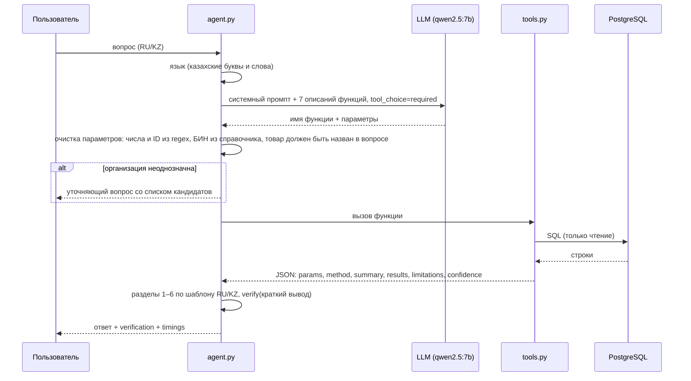
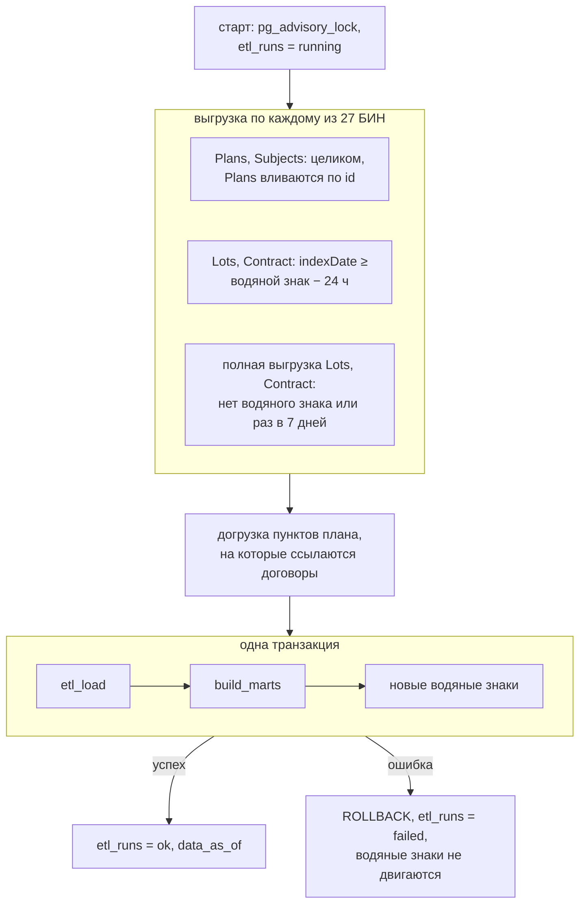

# Архитектура

## Компоненты

PNG-версия схемы: [architecture_components.png](img/architecture_components.png)

**Принцип:** LLM только выбирает инструмент. Числа считает SQL, текст ответа собирает код из результата
SQL, а проверка сверяет каждое число с данными. Поэтому ответ воспроизводим: тот же вопрос на тех же данных
даёт те же цифры.

**Почему всё внутри контура (on-prem):** данные госзакупок и вопросы не уходят во внешние сервисы.
Модель локальная (Ollama). Интерфейс OpenAI-совместимый, поэтому модель меняется переменными
`LLM_BASE_URL` и `LLM_MODEL` без правки кода (например, на vLLM или более крупную модель).

## Агент

### Конвейер обработки вопроса (`agent.py`)

PNG-версия схемы: [agent_pipeline.png](img/agent_pipeline.png)

### 1. Маршрутизация

- **Вызов LLM:** `chat.completions` с `temperature=0`, 7 функциями и `tool_choice=required`. Системный промпт
  содержит:
  - правила выбора функции («отклонение цены» → аномалии, «адекватна ли цена лота» → Fair Price,
    «шарттар саны» → аналитика и т. д.);
  - требование ничего не придумывать;
  - список 27 организаций с БИН;
  - просьбу писать товар по-русски даже для казахского вопроса.
- **Параметры, которые модель «додумывает», не принимаются.** Так обрабатываются ошибки qwen2.5:7b,
  найденные при оценке:
  - год, порог, top-K, «рост в N раз» берутся только регулярными выражениями из текста вопроса;
  - код ЕНС ТРУ, номер договора и БИН поставщика принимаются, только если они буквально есть в вопросе;
  - номер лота (в том числе вида `33431522-ОЛ-ЗЦП1`), объявления и договора (включая ссылку на портал)
    извлекаются регулярными выражениями;
  - организация определяется по словам названия с весами по редкости (IDF). БИН от модели принимается,
    только если слова его названия есть в вопросе. Если подходят несколько организаций, агент переспрашивает;
  - товар отбрасывается, если он обобщённый или служебный («товары», «цена», «баға») либо не назван
    в вопросе. Названный товар превращается в код ЕНС ТРУ по справочнику (RU и KZ названия,
    транслитерация казахских букв); альтернативные коды показываются в ответе.
- **Если LLM недоступна или не выбрала функцию,** работает классификатор по ключевым словам. Вопрос
  не по теме получает объяснение, на что агент отвечает.

### 2. Инструменты (`tools.py`)

| Функция | Вопросы |
|---|---|
| `find_price_anomalies` | закупки с ценой выше средневзвешенной по ЕНС ТРУ на X% |
| `assess_lot_price` | адекватность цены лота или объявления (Fair Price) |
| `find_volume_spikes` | нетипичное завышение количества относительно прошлых лет |
| `compare_customers` | сравнение цен на товар между заказчиками |
| `purchase_analytics` | сколько договоров, на какую сумму, способы закупки, доля из одного источника, крупнейшие поставщики |
| `contract_lookup` | факты по договору: стороны, даты, суммы, способ, статус, позиции |
| `search_purchases` | поиск лотов по названию |

Все функции работают в транзакции `READ ONLY`. Формулы — в [analytics.md](analytics.md).

### 3. Ответ из 6 пунктов

Для каждого типа вопроса есть функция, которая собирает разделы из JSON инструмента на языке вопроса:

1. **Краткий вывод:** шаблонные предложения, где каждое число подписано полем, из которого взято.
2. **Использованные данные:** источник, период, организация (или все 27), фильтры, сопоставление товара
   с кодом.
3. **Сравнение:** сводные цифры и таблица (средневзвешенная, медиана, N, отклонение, рост и т. д.).
4. **Метрика / метод:** формула и пороги.
5. **Ограничения и уверенность:** уровень уверенности, дата актуальности данных, ограничения метода.
6. **Top-K закупок:** ID и прямые ссылки на договоры и объявления портала.

Краткий вывод от LLM доступен как опция `SUMMARY_MODE=llm`, но выключен. qwen2.5:7b подставляла верные
числа с неверными подписями: например, медиану прошлых лет выдавала за объём текущего года. Проверка чисел
такую ошибку не ловит, поэтому для модели 7B вывод собирается по шаблону. При более крупной модели режим
можно включить: при неподтверждённых числах вывод перегенерируется до 2 раз, затем откатывается на шаблон.

### 4. Проверка чисел

`verify(text, json)` извлекает из текста:
- числа, в том числе `1 234 567,89`;
- даты (`ГГГГ-ММ-ДД`, `ДД.ММ.ГГГГ`);
- 12-значные БИН.

Каждое значение должно найтись в JSON инструмента: точно, с погрешностью до 0,5% или после округления до
0–2 знаков; допускаются ×100 (проценты), /10³, /10⁶, /10⁹. Целые числа до 10 пропускаются («топ-5»).
Величины, которые агент вычисляет сам (доли, отношения), он кладёт в JSON (`derived`), чтобы у них был
источник. Результат возвращается в поле `verification` ответа API.

Проверяется раздел 1. Разделы 2–6 берут числа напрямую из JSON.

### 5. Казахский язык

- **Язык ответа** определяется по казахским буквам (ә, ғ, қ, ң, ө, ұ, ү, һ, і) или словам.
- **На казахском:** шаблоны всех разделов, подписи таблиц, методы, вердикты, типовые ограничения, уточняющие
  вопросы. Названия способов закупки и статусов договоров — из справочника API (`name_kz`).
- **На русском:** названия организаций, товаров и лотов, потому что так они хранятся в источнике.
- **Понимание казахских вопросов:**
  - организации распознаются по словам («Ұлттық госпиталь», «Алатау қонақ үйі»);
  - товары — через `name_kz` справочника ЕНС ТРУ («жұмыртқа» → «Яйцо», «қағаз» → «Бумага»);
  - поиск лотов на казахском идёт через русское название кода.
- **Ошибки моделей:** нормализуются латинские буквы-двойники («кaгaз» с латинской a) и казахские буквы без
  диакритики («кагаз»).

## Обновление данных (`update.py`)

PNG-версия схемы: [update_flow.png](img/update_flow.png)

**Решения и их причины (проверено на API 14–15.10.2026):**

- **Лоты и договоры — инкремент по `indexDate`.** Фильтр отдаёт 8 изменённых лотов из 5 427 за 0,2 с
  вместо 38 с. `indexDate` полнее, чем `lastUpdateDate`.
- **Планы — целиком.** Индекс планов пересобирается ежедневно, фильтр по дате бесполезен. Кроме того,
  пункты плана **пропадают из API без флага удаления**: 8 412 за первую полную выгрузку и ещё 4 869 за
  следующие сутки. Большая часть пропавших уже закуплена: из первых 8 412 у 6 284 есть лоты или договоры.
  Поэтому снимок планов вливается по id, пропавшие пункты остаются в аналитике и отмечаются в журнале
  качества.
- **Раз в 7 дней — полная сверка лотов и договоров.** Удаление без флага инкремент не увидит.
- **Защита от неполной выгрузки.** ETL удаляет из базы лоты, договоры и позиции, исчезнувшие из источника.
  Если исчезло больше 10% строк таблицы, загрузка прерывается (`MassDeleteError`). Эта защита и остановила
  первую полную загрузку, когда пропали пункты плана.
- **Одна транзакция на ETL и витрины.** Запросы агента во время пересборки ждут около 25–30 с, а не получают
  пустые витрины. При сбое ничего не теряется: следующий запуск заберёт то же окно.
- **ETL пишет только изменения** (`IS DISTINCT FROM`). Раньше каждый прогон переписывал около 600 тыс. строк,
  и после трёх прогонов подряд запрос внутри транзакции шёл больше 9 минут.

**Замеры на 27 БИН:**

| Запуск | Длительность | Что заняло время |
|---|---|---|
| Первая полная выгрузка | 217 мин | договоры 9 093 с, из них 8 725 с — зависания API на одном БИН; лоты 2 619 с; планы 1 284 с |
| Инкремент | 11–24 мин | почти целиком полная выгрузка планов (10–23 мин); лоты 16–19 с, договоры 3–9 с; ETL и витрины 25–28 с |

**Актуальность данных.** `etl_runs.data_as_of` — время начала последней успешно загруженной выгрузки. Агент
пишет его в каждом ответе («Данные актуальны на …»), `/health` возвращает `data_stale = true`, если данным
больше 24 ч. Требование ТЗ — задержка не больше 24 ч — выполняется расписанием каждые 6 ч.

## Развёртывание

### Docker Compose

`docker compose up -d --build` поднимает:

| Сервис | Образ | Назначение |
|---|---|---|
| `postgres` | postgres:16 | хранилище, порт 5433, том `udp_rk_pgdata` |
| `ollama` | ollama/ollama:0.30.10 | LLM, `OLLAMA_KEEP_ALIVE=-1`, том с моделью |
| `ollama-pull` | ollama/ollama:0.30.10 | разовая загрузка модели |
| `agent` | goszakup-agent (Dockerfile) | FastAPI на 8080, healthcheck `/health` |
| `updater` | goszakup-agent | `scheduler.py`: `update.py` при старте и каждые 6 ч |

Образ один на агента и обновление: python:3.12-slim, пользователь 10001, 288 МБ. Токен API в образ не
попадает (`.dockerignore`), передаётся переменной окружения только сервису `updater`.

На Mac модель в контейнере работает только на CPU: 4–11 с на вопрос, первый запрос после загрузки модели
около 130 с. Для разработки `docker-compose.host-llm.yml` подключает Ollama хоста (Metal, около 2 с).

### Kubernetes

Манифесты в `k8s/` (собираются `kubectl kustomize k8s/`; на кластере не проверялись):
- StatefulSet postgres;
- Deployment ollama (+ init-контейнер загрузки модели, место под GPU);
- Deployment agent (2 реплики, пробы `/health`);
- CronJob updater (`0 */6 * * *`, `concurrencyPolicy: Forbid`, `Asia/Almaty`);
- ConfigMap, Secret (шаблон), PVC для сырых данных и модели.

Описание — в [k8s/README.md](../k8s/README.md).
