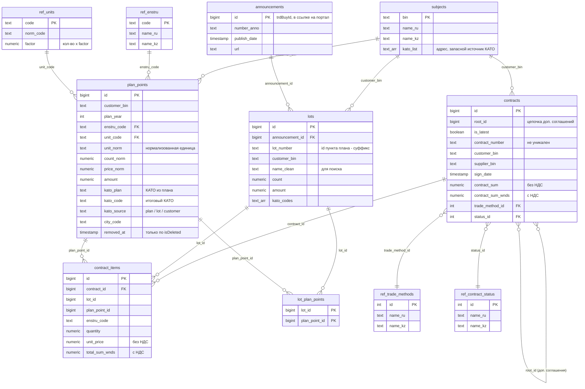

# Схема хранения

Хранилище — PostgreSQL 16. Слои:

1. **Сырые снимки API:** `data/raw/<Entity>/<БИН>.jsonl`. Это постоянное хранилище: база целиком
   пересобирается из них.
2. **Чистые таблицы:** `schema.sql`, загружаются через `etl_load.py`.
3. **Витрины аналитики:** `analytics.sql`, пересобираются через `build_marts.py`.

Цифры ниже — на 16.10.2026 (данные API на 16.10.2026 02:14), по 27 организациям из `bins.txt`.

## Охват данных и обоснование выбора сущностей

Сущности OWS v3 выбраны по двум вопросам: что нужно для трёх обязательных типов вопросов (цена позиции,
количество в плане, место поставки, аналоги других ведомств) и что даёт объяснимость (ID и ссылки на портал).

### Минимальный набор из ТЗ

| Сущность (ТЗ) | Эндпоинт OWS v3 | Фильтр выгрузки | Таблица | Зачем |
|---|---|---|---|---|
| объявления | `TrdBuy` (вложено в `Lots`) | — | `announcements` | номер и дата публикации, статус, ссылка на портал |
| план | `Plans` (`PlnPoint`) | `subjectBiin`, `plnPointYear` 2024–2026 | `plan_points` | код ЕНС ТРУ, единица, количество, цена и сумма плана, место поставки (КАТО) — единственный источник единицы и города |
| договоры | `Contract` + `ContractUnits` | `customerBin`, `signDate` 2024–2026 | `contracts`, `contract_items` | фактическая цена за единицу и количество, стороны, суммы с НДС и без, доп. соглашения |
| лоты | `Lots` | `customerBin`, год по `TrdBuy.publishDate` | `lots`, `lot_plan_points` | связь объявления с пунктами плана; номер лота для вопросов «лот № …» |
| вид предмета (товары / работы / услуги) | `refSubjectTypeId` + `RefSubjectType` в `Plans` и `TrdBuy` | — | `plan_points.subject_type_id`, `announcements.subject_type_id`, `ref_subject_type` | услуги и работы исключаются из сравнения цен за единицу и объёмов (их «цена за единицу» — цена договора) |
| заказчики | `Subjects` | `bin` | `subjects` | названия RU/KZ, адрес (запасной источник КАТО) |
| поставщики | `Contract.supplierBiin`, `Contract.Supplier` | — | `contracts.supplier_*`, представление `v_suppliers` | крупнейшие поставщики, доля из одного источника; отдельной выгрузки поставщиков 27 заказчиков в API нет |
| статусы / результаты | `RefContractStatus`, `RefLotsStatus`, `TrdBuy.RefBuyStatus`, `RefPlnPointStatus` | — | `ref_contract_status`, `lots.status_name`, `ref_buy_status`, `ref_plan_status` | «закупка состоялась / не состоялась», «исполнен», «расторгнут» в ответах и фильтрах |
| справочники | `RefUnits`, `RefEnstru`, `FaktTradeMethods` | — | `ref_units`, `ref_enstru`, `ref_trade_methods` | нормализация единиц, названия кодов ЕНС ТРУ RU/KZ, способы закупки |

Отдельных запросов-справочников в OWS v3 нет: названия приходят во вложенных полях и сохраняются ETL
и `fetch_refs.py`.

### Что не загружается и почему

| Эндпоинт | Содержание | Почему не нужен |
|---|---|---|
| `ObTrdBuy`, `ObContract`, `ObLots`, `ObPlans` | те же структуры, что основные сущности | проверено на Больнице МЦ УДП: все 7 516 договоров из нашей выгрузки есть в `ObContract` с теми же id; из 7 527 записей `ObContract` за 2024–2026 у нас нет 11 (10 в статусе 470, 1 действующий, вероятно новее выгрузки). Остальное — другие годы и неподписанные проекты. Дублирование не добавляет данных для анализа |
| `TrdApp` | заявки поставщиков на участие | для оценки цены и объёма достаточно итоговых договоров; заявки нужны для анализа конкуренции, в ТЗ его нет |
| `Acts`, `ContractWaybill*` | акты выполненных работ, накладные | исполнение договоров; для справедливости цены и аномалий не используется |
| `ComplaintAppeal` | жалобы | вне задач агента |
| `Rnu`, `qualifiedSuppliers` | реестр недобросовестных поставщиков, квалифицированные поставщики | возможное расширение: пометка рисков поставщика в ответах |
| `News` | новости портала | не данные закупок |

### Очистка и нормализация (ETL)

- **Названия лотов и пунктов плана** (`name_clean`, используется в поиске):
  - нижний регистр, `ё` → `е`;
  - удаляются служебные вставки: «Лот №5», «лот 3», «4-Лота.», «согласно технической спецификации». Вставка
    вырезается только как отдельное слово: прежняя версия вырезала «лот» и внутри слов («кислота» → «кис»,
    «полотенце» → «по»);
  - удаляются кавычки, двойные пробелы и пунктуация по краям;
  - описание добавляется к названию, только если не повторяет его. Раньше при одинаковых полях получалось
    «работы по уборке снега работы по уборке снега».
- **Единицы измерения:** грамм и тонна → кг, мл и м³ → литр, погонный метр → метр. Количество умножается
  на коэффициент, цена делится на него.
- **Место поставки:** КАТО из плана, иначе из лота, иначе из адреса заказчика. Пустой КАТО (`''`) городом не
  считается.
- **Доп. соглашения:** в аналитике только последняя редакция договора (`is_latest`).
- **Удаления в источнике:** лоты, договоры и позиции, исчезнувшие из API, удаляются (с защитой от массового
  удаления). Пункты плана помечаются только по флагу `isDeleted` (см. «Ключевые правила преобразования»).
- **Журнал качества** (`dq_issues`): ничего не отбрасывается молча, каждая проблема записывается
  (таблица в конце документа).

## ER-диаграмма

PNG-версия схемы: [er_diagram.png](img/er_diagram.png)

Внешних ключей в базе мало: `plan_points → ref_enstru`, `lots → announcements`, `lot_plan_points → lots`
и `contract_items → contracts` (последние два с каскадным удалением). Остальные связи логические.
Причина: позиции договоров ссылаются на пункты плана прошлых лет и других организаторов, которых может
не быть в выгрузке (11 954 таких id API не отдаёт).

## Таблицы

| Таблица | Строк | Источник в API | Что хранит |
|---|---|---|---|
| `subjects` | 27 | `Subjects` | организации: название RU/KZ, адрес (КАТО) |
| `plan_points` | 81 173 | `Plans` (+ `RefUnits`, `RefEnstru`, `PlansKato`) | пункты годовых планов 2024–2026: код ЕНС ТРУ, единица, количество, цена, сумма, место поставки |
| `announcements` | 36 273 | `Lots.TrdBuy` | объявления (торги): номер, дата публикации, ссылка на портал |
| `lots` | 115 800 | `Lots` | лоты объявлений 2024–2026: номер, название, количество, сумма, статус |
| `lot_plan_points` | 152 705 | `Lots.pointList` | связь лот ↔ пункты плана. 3 466 лотов состоят из нескольких пунктов, до 100 |
| `contracts` | 36 922 (последних редакций 30 616) | `Contract` | договоры: стороны, даты, суммы с НДС и без, способ закупки, статус. Доп. соглашение — новая запись с тем же `root_id` |
| `contract_items` | 105 691 | `Contract.ContractUnits` | позиции договоров: фактическая цена за единицу, количество, ссылка на пункт плана и лот |
| `ref_units` | 44 | `Plans.RefUnits` | единицы измерения и правила нормализации (грамм/тонна → кг, мл/м³ → литр, пог. м → метр) |
| `ref_enstru` | 9 383 | `Plans.RefEnstru` | справочник ЕНС ТРУ RU/KZ |
| `ref_trade_methods` | 12 | `Contract.FaktTradeMethods` | способы закупки RU/KZ (`fetch_refs.py`) |
| `ref_contract_status` | 10 | `Contract.RefContractStatus` | статусы договоров RU/KZ |
| `ref_subject_type` | 3 | `RefSubjectType` (план, объявление) | вид предмета: товар, работа, услуга; у пунктов плана — `subject_type_id` (69 754 из 81 173, у остальных 11 419 поля в API нет) |
| `ref_plan_status` | 20 | `Plans.RefPlnPointStatus` | статусы пунктов плана RU/KZ («Утвержден», «Договор действует», «Исполнен» …) |
| `ref_buy_status` | 10 | `TrdBuy.RefBuyStatus` | статусы объявлений RU/KZ («Завершено», «Изменена документация» …) |
| `v_suppliers` (view) | 9 093 | `Contract.supplierBiin`, `Supplier` | поставщики: число договоров и заказчиков, сумма, первый и последний договор |
| `ref_cpi` | 33 | `cpi.csv` | помесячный ИПЦ Бюро нацстатистики (январь 2024 — сентябрь 2026, декабрь 2023 = 100): приведение цен к ценам последнего месяца |
| `dq_issues` | 60 787 | ETL | журнал качества данных, см. ниже |
| `etl_state` | 108 | `update.py` | водяные знаки инкремента (сущность × БИН) |
| `etl_runs` | 15 | `update.py` | журнал запусков обновления: режим, статус, `data_as_of`, статистика, ошибка |

## Ключевые правила преобразования (ETL)

- **Цена за единицу** берётся из позиции договора (`contract_items.unit_price`, без НДС). Единица измерения
  и место поставки есть только в плане, поэтому позиция связывается с пунктом плана:
  - напрямую по `plan_point_id`;
  - если такого пункта нет (старая редакция плана) — через лот, по пункту с тем же кодом ЕНС ТРУ
    (`plan_source = via_lot`, 301 позиция).
- **Нормализация единиц:** количество × `factor`, цена / `factor`.
- **Город поставки:** КАТО[:2] для Астаны (71), Алматы (75) и Шымкента (79), иначе КАТО[:4]. Источник КАТО
  по порядку:
  - план (34 742 пункта);
  - лот (22 625);
  - адрес заказчика (23 791).

  Пустой КАТО в лоте (`''`) не считается городом.
- **Доп. соглашения:** в аналитике участвует только последняя редакция договора (`contracts.is_latest`).
- **Удаления в источнике:**
  - лоты, договоры, позиции и связи, которых больше нет в сырых данных или которые помечены `deleted`,
    удаляются;
  - пункты плана помечаются `removed_at` только по флагу `isDeleted`;
  - пропажа пункта плана из выгрузки API удалением **не** считается (см. [риски](risks.md#данные)).
- **Запись только изменений:** UPSERT с условием `IS DISTINCT FROM`. Повторный прогон ETL на тех же данных
  не переписывает ни одной строки (проверяется в `test_update.py`).

## Витрины (`analytics.sql`)

| Объект | Строк | Что считает |
|---|---|---|
| `v_price_facts` (view) | 78 326 | позиция последней редакции договора + пункт плана: нормализованные цена, количество и единица, город, признак «услуга/работа» (по виду предмета из API, при его отсутствии — по единице) |
| `mv_price_base` | 76 031 | `v_price_facts` с ценой > 0 и известной единицей; `price_real` — цена в ценах последнего месяца ИПЦ (сентябрь 2026) |
| `mv_enstru_stats` | 11 947 (N ≥ 5: 3 466) | по (код ЕНС ТРУ, единица): N, число заказчиков, медиана, Q1, Q3, IQR, средневзвешенная по количеству, MAD |
| `mv_enstru_city_stats` | 15 766 | то же в разрезе города поставки |
| `mv_season` | 643 (коэффициент ≠ 1: 208) | сезонный коэффициент раздела КПВЭД (ЕНС ТРУ[:2]) по месяцу |
| `v_price_anomalies` (view) | — | отклонение от средневзвешенной, robust z, выход за Q3 + 1,5·IQR, переплата |
| `mv_volumes` | 39 733 | плановое количество по (заказчик, код, единица, год), без пунктов с `removed_at` |
| `v_volume_growth` (view) | — | количество года против медианы прошлых лет, рост, сумма на прирост |

Формулы — в [analytics.md](analytics.md).

## Журнал качества данных (`dq_issues`)

| Проблема | Записей | Значение |
|---|---|---|
| `kato_fallback` | 46 416 | у пункта плана нет КАТО в самом плане, место поставки взято из лота или адреса заказчика |
| `missing_from_api` | 10 969 | пункт плана пропал из выгрузки API, но сохранён в последней известной версии |
| `no_plan_point_unit_unknown` | 2 295 | у позиции договора не найден пункт плана: единица неизвестна, позиция не участвует в ценовой аналитике |
| `sum_mismatch` | 757 | цена × количество ≠ сумме позиции больше чем на 1% |
| `plan_point_via_lot` | 301 | пункт плана найден через лот, а не по прямой ссылке |
| `bad_price` | 40 | у пункта плана нет цены или она ≤ 0 |
| `deleted_in_source` | 6 | запись помечена удалённой в API |
| `bad_price_or_qty` | 2 | у позиции договора нет цены или количества |
| `foreign_currency` | 1 | договор не в тенге (исключён из сумм аналитики) |
